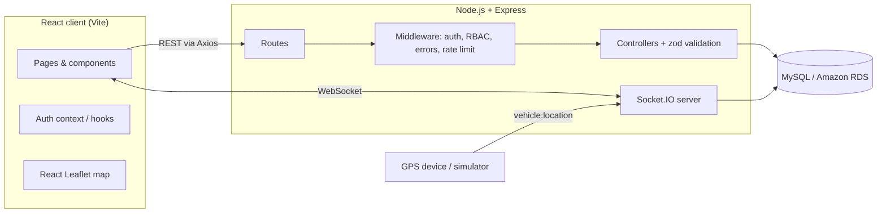

# 🚚 FleetTrack — Real-Time Logistics & Fleet Tracking System


A full-stack, real-time logistics and fleet management platform. Dispatchers watch vehicles move on a live map, create and assign shipments, and follow every delivery from pickup to drop-off. Managers get dashboards and reports. Customers can track a parcel on a public page without logging in.

The UI follows a warm "delivery app" look: cream background, yellow accents, a white sidebar, a shipping-detail panel beside a large map, and plain-language help on every screen.

---

## 📑 Table of Contents

1. [Quick Start](#-quick-start)
2. [Troubleshooting](#-troubleshooting)
3. [Features](#-features)
4. [System Architecture](#-system-architecture)
5. [Technology Stack](#-technology-stack)
6. [Project Structure](#-project-structure)
7. [Data Models](#-data-models)
8. [REST API Reference](#-rest-api-reference)
9. [Real-Time Events](#-real-time-events-socketio)
10. [Roles & Permissions](#-roles--permissions)
11. [Configuration](#-configuration)
12. [Running with Docker](#-running-with-docker)
13. [GPS Simulator](#-gps-simulator)
14. [Testing](#-testing)
15. [Security](#-security)
16. [CI/CD & Deployment](#️-cicd--deployment)
17. [Roadmap](#-roadmap)
18. [Contributing](#-contributing) · [License](#-license)

---

## 🚀 Quick Start

Install Node.js 18 or newer and npm. For the demo, create a disposable MySQL database named `fleet_tracking_demo` and a database user with access to it. To use a real fleet database on AWS, follow [Start with real fleet data](#start-with-real-fleet-data).

### Option A: one command from the repo root (recommended)

```bash
npm install          # root launcher tools (concurrently, wait-on)
npm run setup        # installs server/ and client/ dependencies
cp server/.env.example server/.env
cp client/.env.example client/.env
# Set DB_USER and DB_PASSWORD in server/.env.
npm run db:init
npm run seed         # resets the demo tables and inserts sample records
npm run dev:all      # API on :5000, client on :5173, and the GPS simulator, all in one terminal
```

Other root scripts: `npm run dev` (API + client, no simulator), `npm run simulate`, `npm test` (server tests) and `npm run build` (client production build). Press `Ctrl+C` once to stop everything.

### Option B: three terminals

```bash
# 1. Backend
cd server
npm install
cp .env.example .env
# Set DB_USER and DB_PASSWORD in .env.
npm run db:init
npm run seed        # creates demo users, vehicles, drivers and shipments
npm run dev         # API + sockets on http://localhost:5000

# 2. Frontend (new terminal)
cd client
npm install
cp .env.example .env
npm run dev         # app on http://localhost:5173

# 3. Make the vehicles move (new terminal)
cd server
npm run simulate
```

### Option C: one double-click (Windows) or one script (macOS / Linux)

Configure the MySQL demo credentials in `server/.env` and run `npm run db:init` and `npm run seed`. Use `scripts\start-local.cmd` on Windows or `bash scripts/start-local.sh` on macOS and Linux to start the API, client, and simulator.

### Try the production build locally

```bash
npm run serve      # builds the client, then the API serves it at http://localhost:5000
```

This is exactly what runs on a server: one Node process serving both the API and the built client (`SERVE_CLIENT=true`).

### Start with real fleet data

Install the dependencies and create or select a MySQL database in Amazon RDS. Copy `server/.env.production.example` to `server/.env` for a new install. Fill in the connection settings from your RDS instance and MySQL user. [Amazon RDS connection guide](https://docs.aws.amazon.com/AmazonRDS/latest/UserGuide/USER_ConnectToInstance.html)

| Setting | Value |
|---|---|
| `DB_HOST`, `DB_PORT` | RDS endpoint hostname and port (typically `3306`) |
| `DB_NAME` | MySQL database name, for example `fleet_tracking_live` |
| `DB_USER`, `DB_PASSWORD` | MySQL database username and password |
| `DB_SSL`, `DB_SSL_CA` | `true` and `certs/rds-global-bundle.pem` |
| `JWT_ACCESS_SECRET`, `JWT_REFRESH_SECRET` | Two distinct random strings. Run `node -p "require('crypto').randomBytes(48).toString('hex')"` twice to generate them. |
| `HOST` | `127.0.0.1` for access from this computer |
| `CLIENT_URL` | `http://localhost:5000` for a local server, or your site's HTTPS origin when deployed |
| `NODE_ENV`, `SERVE_CLIENT` | `production`, `true` |
| `DEMO_MODE`, `TRUST_PROXY` | `false` and `0` for a local server. The EC2 setup uses `TRUST_PROXY=1` behind Nginx. |

Download the RDS CA bundle to `server/certs/rds-global-bundle.pem`. The API validates the database endpoint and certificate over TLS. The machine running FleetTrack needs a network route to RDS and access to its MySQL port through the RDS security group. [AWS certificate bundles](https://docs.aws.amazon.com/AmazonRDS/latest/UserGuide/UsingWithRDS.SSL.html) · [AWS RDS connectivity](https://docs.aws.amazon.com/AmazonRDS/latest/UserGuide/USER_ConnectToInstance.html)

Run `npm run db:init` from the project root with credentials that can create tables, indexes, and foreign keys in the database. This command can be rerun and preserves existing MySQL records. For an established schema, the API uses ordinary read and write access.

Add `ADMIN_NAME` (your full name), `ADMIN_EMAIL` (your work email), and `ADMIN_PASSWORD` (a unique password of at least 15 characters and at most 72 UTF-8 bytes) to `server/.env`. Quote values with spaces or `#`. Run `npm run admin:create` once from the root, then remove the three `ADMIN_*` values. The command creates an admin account in the configured database and preserves any existing account with the same email.

Run `npm run serve` and sign in at [http://localhost:5000](http://localhost:5000). Start by adding your vehicles and drivers, then create shipments. A vehicle appears on the map after its first position arrives from a GPS device gateway. Native installs read `server/.env`. The root `.env` is for Docker Compose, and `client/.env` is for browser-facing settings.

### Sign in to the demo

Open **http://localhost:5173**. The login page has one-click demo-account chips, or type:

| Role | Email | Password |
|---|---|---|
| Admin | `admin@fleet.com` | `Admin@123` |
| Manager | `manager@fleet.com` | `Manager@123` |
| Dispatcher | `dispatcher@fleet.com` | `Dispatch@123` |

Then open **Live tracking** to see the four seeded trucks driving toward their destinations. At the simulator's default speed-up they arrive within a few minutes; after that, create a shipment on the **Shipments** page, assign a vehicle, and press **Start transit** to put a new truck on the road. The public tracking page is at `/track` (try any tracking ID from the Shipments page).

> ⚠️ The demo accounts are for development only. Never run `npm run seed` against a production database (it wipes all collections) and remove the demo users before going live.

---

## 🔧 Troubleshooting

| Symptom | Cause and fix |
|---|---|
| Red overlay in the browser: *"The `bg-cream` class does not exist"* | The Vite dev server was started before `client/tailwind.config.js` changed and kept the old config in memory. Stop the client (`Ctrl+C`) and start it again. |
| Production site shows a blank page or missing fonts/tiles | Check the browser console for Content-Security-Policy errors; the allowed sources are set in `server/src/app.js`. Make sure `CLIENT_URL` in `server/.env` is the address you open in the browser. |
| `Port 5173 is already in use` | A previous dev server is still running. Close that terminal, or on Windows run `netstat -ano \| findstr :5173` and then `taskkill /PID <pid> /F`. |
| MySQL connection fails | Check the endpoint, port, database name, username and password. For RDS, also check the network route, security group and `DB_SSL_CA`. |
| FleetTrack MySQL schema is incomplete | Run `npm run db:init` using a MySQL user with schema creation privileges. |
| Simulator says `No In Transit shipments yet` | Every shipment has been delivered. With `npm run dev:all` the simulator books new trips by itself within 10 seconds; otherwise create and dispatch one in the UI, or run `npm run seed` to reset the demo data. |
| Map tiles are blank | Tiles come from `server.arcgisonline.com` (Esri) and need internet access. To use another provider, set `VITE_MAP_TILE_URL` in `client/.env`. |
| Top bar shows **Reconnecting** | The client lost its socket to the API. Make sure the API is running on port 5000 and that `client/.env` points to it. |

---

## ✨ Features

### 📊 Dashboard
- Vehicle KPIs: total, moving, idle/stopped, in maintenance.
- Shipment KPIs: ongoing, waiting for assignment, delivered this week, on-time rate, fleet utilization, each with a sparkline and a "vs last week" line.
- Charts (Recharts): deliveries in the last 7 days (bars + trend line), fleet status and shipments by status as labelled stacked bars.
- Featured shipment card with a mini map and a checkbox-style timeline, a recent shipments table with CSV export, and a live activity feed of departures, deliveries and alerts. KPIs count up or down live when shipments or vehicle status change.

### 📍 Live Fleet Tracking
- Full-height interactive map (React Leaflet on Esri street tiles, with a Map / Satellite switch on every map) with white truck markers coloured by status.
- Positions update in real time over Socket.IO (no polling).
- **Shipping detail** panel for the selected vehicle: driver, time left, distance to go, ETA, a segmented progress bar, "on schedule" check, current speed, and a timeline of the trip.
- Floating search (plate or driver name) and status filter over the map; a scrollable strip of vehicle cards along the bottom. Click a card or marker to focus it.
- Connection indicator in the top bar ("Live" / "Reconnecting").

### 🚛 Vehicle Management
- Add, edit, delete, search and filter vehicles; export the list as CSV.
- Registration, type, make/model, capacity, fuel type, status (`moving`, `booked`, `idle`, `stopped`, `offline`, `maintenance`), assigned driver.
- Next service date and insurance expiry, highlighted when due within 30 days.

### 👨‍✈️ Driver Management
- Driver profiles with phone, email, license number and expiry (highlighted when due within 30 days).
- Availability status (`available`, `on-trip`, `off-duty`), assigned vehicle, rating; CSV export.

### 📦 Shipment Management
- Create shipments with an auto-generated tracking ID (`SHP-YYYYMMDD-XXXXXX`, six random characters so IDs cannot be guessed); distance and ETA are calculated automatically. Customer names and phone numbers are validated.
- Assign an idle vehicle and an available driver in one dialog. Vehicles rated below the shipment weight are not offered, and the API rejects them too. An assigned vehicle becomes **booked** (and **moving** once in transit) so it cannot be double-booked.
- Guided status lifecycle: `Created → Assigned → Picked Up → In Transit → Delivered` (or `Failed` / `Cancelled`). Buttons are named after the action ("Start transit", "Mark delivered"), and invalid jumps are rejected by the API.
- A "How it works" guide explains each step, and every status pill has a plain-language tooltip.
- Full status timeline per shipment, status tabs, global search from the top bar, CSV export.
- **Public tracking page** for customers (`/track/:trackingId`): map with the live truck position, a step strip, the driver's first name and vehicle plate, pickup/delivery details and the timeline. It refreshes itself every 15 seconds and shows only customer-safe fields (no customer details, no internal notes, driver first name only). The endpoint is rate limited to 20 requests per minute per address.

### 🗺️ Route Management
- Source, destination, distance and driving-time estimate for every shipment, drawn on a map.
- Multi-stop planner that finds the shortest visiting order: exact for up to 8 stops, nearest-neighbour plus 2-opt beyond that.

### 📈 Reports & Analytics
- Deliveries per day (7/30/90 days, bucketed in the fleet's local time zone), vehicle utilization, driver performance, on-time rate.
- CSV export for each table; print or save as PDF through the browser.

### 🔔 Alerts
- Automatic alerts for speeding (over 80 km/h, de-duplicated per vehicle) and failed deliveries.
- Real-time toast + unread counter in the top bar; alerts page with mark-as-read and a short note on why each alert type matters.

### 🔐 Authentication & Access Control
- JWT access + refresh tokens; the client refreshes silently when the access token expires.
- Role-based access control (admin, manager, dispatcher, driver) on every API route and in the UI; the driver role is read-only, the other three run operations.

### 🎨 UI
- Design tokens in `client/tailwind.config.js` (cream, ink, sun, ember, leaf, sky, berry, line) with Inter and Outfit fonts.
- Every page has a one-sentence subtitle saying what it is for; forms show required markers and helper text.
- Responsive layout (sidebar collapses on mobile), loading and empty states, toast feedback, keyboard-visible focus, reduced-motion support.
- Login hero with an animated vector globe drawn on a canvas (no extra dependency).

---

## 🏗️ System Architecture



Requests pass through authentication and authorization to controllers and Sequelize models backed by MySQL. Controllers publish Socket.IO updates after database commits.

---

## 🛠️ Technology Stack

### Frontend (`client/`)
| Technology | Purpose |
|---|---|
| React 18 + Vite 5 | UI and build tooling |
| JavaScript (ES2022), HTML5, CSS3 | Application code |
| Tailwind CSS 3 | Styling, design tokens, component classes in `index.css` |
| React Router 6 | Routing, protected and lazy-loaded routes |
| Axios | API client with token refresh interceptor |
| Socket.IO client | Live vehicle and shipment updates |
| React Leaflet + Leaflet | Interactive maps (Esri World Street Map + World Imagery tiles, no API key; custom provider via `VITE_MAP_TILE_URL`) |
| Recharts | Dashboard and report charts |
| React Hot Toast, Lucide React, date-fns | Notifications, icons, dates |
| Google Fonts (Inter, Outfit) | Body and display typefaces |

### Backend (`server/`)
| Technology | Purpose |
|---|---|
| Node.js 18+ / Express 4 | REST API |
| MySQL + Sequelize + mysql2 | Relational storage and MySQL driver for Amazon RDS |
| Socket.IO 4 | Real-time communication |
| jsonwebtoken + bcryptjs | Authentication, password hashing |
| Zod | Request validation |
| Helmet, CORS, express-rate-limit | Security hardening |
| Morgan | HTTP request logging |
| node:test | Unit tests |

### Tooling
- Root `package.json` uses `concurrently` and `wait-on` to run the API, client and simulator from one terminal.
- Docker Compose runs the API and Nginx-served client. The API connects to RDS MySQL, and Nginx proxies `/api` and `/socket.io`.
- GitHub Actions workflow in `.github/workflows/ci.yml`.

---

## 📂 Project Structure

```text
logistics-fleet-tracking/
├── package.json          Root launcher: setup, seed, dev, dev:all, serve, simulate, test, build
├── scripts/              start-local.cmd (Windows) / start-local.sh: one-click local start
├── deploy/               ec2-setup.sh, deploy.sh, ecosystem.config.cjs (PM2), nginx.conf for AWS EC2
├── client/
│   ├── src/
│   │   ├── components/   Layout, CrudPage, MapView, Modal, StatusBadge, DashboardCard,
│   │   │                 Sparkline, Timeline, PageHeader, Avatar, VectorGlobe, Spinner
│   │   ├── pages/        Login, Dashboard, FleetTracking, Vehicles, Drivers, Shipments,
│   │   │                 Routes, Reports, Alerts, TrackShipment (public), NotFound
│   │   ├── context/      AuthContext.jsx
│   │   ├── hooks/        useFleetTracking.js
│   │   ├── routes/       ProtectedRoute.jsx
│   │   ├── services/     api.js (Axios + refresh), socket.js
│   │   ├── utils/        helpers.js (formatting, haversine, trip progress, CSV download)
│   │   ├── App.jsx · main.jsx · index.css (design tokens + .btn/.card/.input classes)
│   ├── Dockerfile · nginx.conf · tailwind.config.js · vite.config.js · package.json · .env.example
│
├── server/
│   ├── src/
│   │   ├── config/       env.js, db.js
│   │   ├── models/       User, Vehicle, Driver, Shipment, Alert, constants
│   │   ├── controllers/  auth, crud (generic), shipment, dashboard, report, route, alert, track
│   │   ├── middleware/   auth (authenticate/authorize), errorHandler
│   │   ├── routes/       index.js
│   │   ├── sockets/      tracking.js (location ingest, speeding alerts), io.js
│   │   ├── services/     alertService.js
│   │   ├── validators/   schemas.js (zod)
│   │   ├── utils/        geo.js, trackingId.js, ApiError.js, asyncHandler.js
│   │   ├── seed/         seed.js, cities.js
│   │   ├── simulator/    simulate.js
│   │   ├── app.js · server.js
│   ├── tests/            geo.test.js
│   ├── Dockerfile · package.json · .env.example · .env.production.example
│
├── .github/workflows/ci.yml · docker-compose.yml · .env.example · .gitignore · LICENSE · README.md
```

---

## 🗃️ Data Models

| Model | Key fields |
|---|---|
| **User** | name, email (unique), passwordHash, role, isActive, lastLogin |
| **Vehicle** | registrationNo (unique), type, make, model, capacityKg, fuelType, status (moving / booked / idle / stopped / offline / maintenance), assignedDriver, location `{lat,lng}`, speed, heading, lastUpdated, nextServiceDate, insuranceExpiry |
| **Driver** | name, phone, email, licenseNo (unique), licenseExpiry, status, rating, assignedVehicle |
| **Shipment** | trackingId (unique), customerName, customerPhone, pickup/delivery `{address,lat,lng}`, weightKg, status, vehicle, driver, distanceKm, eta, deliveredAt, timeline[] |
| **Alert** | type, severity, message, vehicle, shipment, isRead |

---

## 🔌 REST API Reference

Base URL: `/api/v1`. Everything except `/health`, `/auth/login`, `/auth/refresh` and `/track/:trackingId` needs `Authorization: Bearer <accessToken>`.

| Module | Method | Endpoint | Access |
|---|---|---|---|
| System | GET | `/health` | Public |
| Auth | POST | `/auth/login`, `/auth/refresh` | Public (rate limited) |
| Auth | GET / POST | `/auth/me`, `/auth/logout` | Any user |
| Public | GET | `/track/:trackingId` | Public (rate limited: 20/min) |
| Dashboard | GET | `/dashboard/stats` | Any user |
| Vehicles | GET | `/vehicles`, `/vehicles/:id` | Any user |
| Vehicles | POST / PUT / DELETE | `/vehicles`, `/vehicles/:id` | Admin, manager, dispatcher |
| Drivers | GET / POST / PUT / DELETE | `/drivers`, `/drivers/:id` | Same as vehicles |
| Shipments | GET | `/shipments`, `/shipments/:id` | Any user |
| Shipments | POST | `/shipments` | Admin, manager, dispatcher |
| Shipments | PATCH | `/shipments/:id/assign`, `/shipments/:id/status` | Admin, manager, dispatcher |
| Shipments | DELETE | `/shipments/:id` | Admin |
| Routes | GET | `/routes/:shipmentId` | Any user |
| Routes | POST | `/routes/optimize` | Admin, manager, dispatcher |
| Reports | GET | `/reports/deliveries`, `/reports/vehicles`, `/reports/drivers` | Admin, manager, dispatcher |
| Alerts | GET / PATCH | `/alerts`, `/alerts/:id/read`, `/alerts/read-all` | Any user |

List endpoints accept `page`, `limit` (max 200), `search` and a `status` filter (plus `type` for vehicles). A filter can list several values: `status=Assigned,In Transit`.

`POST /shipments` expects `customerName`, optional `customerPhone`, `weightKg`, and `pickup` / `delivery` objects of the form `{ address, lat, lng }`. `PATCH /shipments/:id/assign` takes `{ vehicleId, driverId }`; `PATCH /shipments/:id/status` takes `{ status, note? }`.

`GET /track/:trackingId` returns the tracking ID, status, from/to, pickup and delivery coordinates, weight, distance, ETA, the timeline, and, while the shipment is in transit, the live vehicle position, the vehicle plate and type, and the driver's first name. Customer name and phone are never returned.

```jsonc
// success
{ "success": true, "data": {}, "meta": { "page": 1, "limit": 50, "total": 134 } }
// error
{ "success": false, "message": "Validation failed", "errors": [{ "field": "email", "message": "Invalid email" }] }
```

---

## ⚡ Real-Time Events (Socket.IO)

Clients connect with the same JWT (`auth: { token }`) and join the `fleet` room automatically.

| Event | Direction | Payload |
|---|---|---|
| `vehicle:location` | Device → server | `{ vehicleId, lat, lng, speed, heading }` (admin/manager/dispatcher tokens only) |
| `vehicle:location` | Server → clients | `{ vehicleId, lat, lng, speed, heading, status, timestamp }` |
| `vehicle:status` | Server → clients | `{ vehicleId, status }` |
| `shipment:update` | Server → clients | `{ shipmentId, status, eta }` |
| `alert:new` | Server → clients | Alert document |

---

## 👥 Roles & Permissions

| Capability | Admin | Manager | Dispatcher | Driver |
|---|:---:|:---:|:---:|:---:|
| View dashboard, map, shipments, vehicles, drivers | ✅ | ✅ | ✅ | ✅ (read-only) |
| Create / assign shipments, update status | ✅ | ✅ | ✅ | ❌ |
| Add / edit / delete vehicles and drivers | ✅ | ✅ | ✅ | ❌ |
| View reports | ✅ | ✅ | ✅ | ❌ |
| Delete shipments (erases delivery history) | ✅ | ❌ | ❌ | ❌ |

Admin, manager and dispatcher are all operations roles with the same day-to-day powers; admin additionally deletes shipments. Change the lists at the top of `server/src/routes/index.js` (and the matching checks in `client/src/components/CrudPage.jsx`, `Layout.jsx`, `App.jsx`) to tighten this.

---

## 🔑 Configuration

**`server/.env`** (copy from `server/.env.example`)

```env
NODE_ENV=development
PORT=5000
DB_HOST=127.0.0.1
DB_PORT=3306
DB_NAME=fleet_tracking_demo
DB_USER=fleettrack
DB_PASSWORD=
DB_SSL=false
DEMO_MODE=true
JWT_ACCESS_SECRET=change_me_access
JWT_REFRESH_SECRET=change_me_refresh
JWT_ACCESS_EXPIRES=15m
JWT_REFRESH_EXPIRES=7d
CLIENT_URL=http://localhost:5173
```

Optional: `REPORT_TZ=Asia/Kolkata` sets the time zone used to group deliveries by day on the dashboard and reports (default: the server's own zone).

In production the JWT secrets must be distinct, at least 32 characters long, and use generated values. `DEMO_MODE=true` enables demo seeding and simulation. Use it only with a disposable demo database.

**`client/.env.production`** (committed) points the production build at relative URLs (`/api/v1`, same-origin sockets), so the build works wherever it is served from.

**`client/.env`** (copy from `client/.env.example`)

```env
VITE_API_BASE_URL=http://localhost:5000/api/v1
VITE_SOCKET_URL=http://localhost:5000
VITE_SHOW_DEMO_ACCOUNTS=true
# Optional: replace the street basemap with any XYZ tile provider
# VITE_MAP_TILE_URL=https://api.maptiler.com/maps/streets-v2/{z}/{x}/{y}.png?key=YOUR_KEY
# VITE_MAP_TILE_ATTR=&copy; MapTiler &copy; OpenStreetMap contributors
```

Vite reads `client/.env` at start-up, so restart the client after changing it. Set `VITE_SHOW_DEMO_ACCOUNTS=false` for real-data development. The production build hides the demo sign-in shortcuts by default. Keep credentials in `server/.env` and leave that file out of version control.

---

## 🐳 Running with Docker

Copy `.env.example` to the root `.env`, set the RDS connection and JWT secrets, and download the RDS CA bundle. Compose binds the certificate into the server container using `DB_SSL_CA_PATH`.

```bash
docker compose build
docker compose run --rm server npm run db:init
docker compose up --build
```

| Service | URL |
|---|---|
| App (Nginx) | http://localhost:3000 |
| API | http://localhost:5000/api/v1/health |

For a demo, point the root `.env` at a disposable MySQL database and set `DEMO_MODE=true` before bringing the stack up.

```bash
docker compose exec server npm run seed
docker compose exec server npm run simulate
```

---

## 🛰️ GPS Simulator

`npm run simulate` (from the root or from `server/`) requires `DEMO_MODE=true` in both its configuration and the target API. It logs in as the demo admin, finds every **In Transit** shipment, and drives its vehicle toward the destination, pushing `vehicle:location` events. It re-scans for new In Transit shipments every 10 seconds, marks each shipment **Delivered** on arrival, and occasionally spikes above 80 km/h to trigger speeding alerts.

```bash
npm run simulate -- --interval=2000 --speedup=40 --vehicles=10
```

`--interval` is the milliseconds between position updates, `--speedup` multiplies real driving speed so a trip finishes in minutes, and `--vehicles` caps how many trucks move at once. Add `--auto` (or `--auto=5`) for demo mode: whenever fewer than three (or five) trips are on the road, the simulator books a new shipment between two cities, assigns a free vehicle and driver, and sends it out, so the live map never goes quiet. `npm run dev:all` starts the simulator in this mode. Override credentials with `SIM_EMAIL`, `SIM_PASSWORD` and `API_URL`.

To connect real hardware, configure a gateway for your tracker or GPS provider. The gateway authenticates with the API, connects to Socket.IO using the access token, and emits `vehicle:location` with the FleetTrack vehicle ID, latitude, longitude, speed in km/h, and heading. Provider credentials belong with the gateway.

---

## 🧪 Testing

```bash
npm test             # from the root, or: cd server && npm test
npm run build        # client production build; also catches Tailwind/JSX errors
```

Server tests cover the geo utilities. CI also runs the MySQL integration test against a disposable MySQL 8.4 database. To run that test locally, initialize a dedicated test database, set its `DB_*` variables, and run `npm test` with `NODE_ENV=test`, `DEMO_MODE=false` and `MYSQL_INTEGRATION_TEST=1`.

---

## 🔐 Security

- Passwords hashed with bcrypt (12 rounds); hashes are never returned by the API.
- Short-lived JWT access tokens plus refresh tokens; sockets use the same JWT.
- Role checks on every protected route; unknown body fields are stripped by zod (no mass assignment). Validation errors come back as readable sentences, e.g. "Customer phone must contain 7 to 15 digits".
- Helmet headers, CORS limited to `CLIENT_URL`, JSON body limit, rate limiting on login and refresh.
- Query filters use a field allowlist, and search matches literal text.
- Public tracking exposes only customer-safe fields: no customer name or phone, no internal timeline notes, and the driver's first name only. Tracking IDs carry six random characters and the endpoint is rate limited, so IDs cannot be enumerated.
- Secrets come from environment variables; `.env` is git-ignored.

Before real production use also add HTTPS (Nginx/TLS), refresh-token revocation, and remove the demo accounts.

---

## ☁️ CI/CD & Deployment

### Deploy to AWS EC2 (no Docker)

The EC2 instance runs Nginx and Node, which serves the API and built client. FleetTrack connects to an Amazon RDS MySQL instance. The scripts live in `deploy/`.

1. **Launch an instance.** Use Ubuntu Server 22.04 or 24.04. Allow SSH and web traffic to EC2 as needed. Configure the RDS security group to allow MySQL access from the EC2 application security group. [AWS RDS connectivity](https://docs.aws.amazon.com/AmazonRDS/latest/UserGuide/USER_ConnectToInstance.html)
2. **Connect** with SSH: `ssh -i your-key.pem ubuntu@<public-ip>`.
3. Run the setup script. On the first run it installs Node, Nginx and PM2, clones the repo into `/opt/fleettrack`, generates JWT secrets and downloads the RDS certificate bundle.

   ```bash
   curl -fsSL https://raw.githubusercontent.com/Sharanpreet27-Singh/logistics-tracking-project/main/deploy/ec2-setup.sh -o ec2-setup.sh
   bash ec2-setup.sh
   ```

   Enter the `DB_*` settings in `/opt/fleettrack/server/.env`, then rerun `bash ec2-setup.sh` to initialize the database schema, build the client, and start the API.
4. Add your `ADMIN_*` values to `/opt/fleettrack/server/.env` and run `npm run admin:create` from `/opt/fleettrack`. Remove the `ADMIN_*` values once the account is created. Sign in after HTTPS is configured.
5. **Updates:** `cd /opt/fleettrack && bash deploy/deploy.sh` pulls, rebuilds and reloads with zero downtime.
6. **HTTPS:** point a domain at the instance, set `CLIENT_URL=https://your-domain.com` in `server/.env`, then `sudo apt-get install -y certbot python3-certbot-nginx && sudo certbot --nginx -d your-domain.com`.

What the pieces do: `deploy/ec2-setup.sh` (one-time install), `deploy/deploy.sh` (build + reload, run after every pull), `deploy/ecosystem.config.cjs` (PM2 processes: API, optional simulator), `deploy/nginx.conf` (reverse proxy incl. WebSocket upgrade), `server/.env.production.example` (production settings: `SERVE_CLIENT`, `TRUST_PROXY`, `REPORT_TZ`). Logs: `pm2 logs fleettrack-api`. The API refuses to start in production while the JWT secrets still say `change_me`.

Other options: `docker compose up` on any Docker host (see above), or the client on S3/CloudFront with the API on a container service and `CLIENT_URL` set to the CloudFront origin.

### Continuous integration

The repository includes a GitHub Actions workflow at `.github/workflows/ci.yml` that runs the server tests and the client build on every push and pull request to `main`:

```yaml
name: CI
on:
  push: { branches: [main] }
  pull_request:
jobs:
  build:
    runs-on: ubuntu-latest
    steps:
      - uses: actions/checkout@v4
      - uses: actions/setup-node@v4
        with: { node-version: 20 }
      - run: cd server && npm install && npm test
      - run: cd client && npm install && npm run build
```

---

## 🗺️ Roadmap

Built: dashboard, live map with shipping-detail panel, vehicle/driver/shipment management, routes and planner, reports, alerts, public tracking with live position, JWT auth with RBAC, Docker, GPS simulator, one-command local launcher.

Planned:
- [ ] API tests (Jest + Supertest) and client tests (Vitest), ESLint/Prettier, pre-commit hooks
- [ ] User management screen and refresh-token revocation
- [ ] Trip history playback (store GPS breadcrumbs with a TTL index)
- [ ] Geofencing, idle-time and route-deviation alerts
- [ ] Email / SMS / WhatsApp delivery notifications
- [ ] Driver mobile app with own-shipment view and proof of delivery
- [ ] Road-based routing and AI route optimization
- [ ] Dark mode, marker clustering for large fleets
- [ ] Swagger/OpenAPI docs, Prometheus metrics and Grafana dashboards, structured logging
- [ ] Redis adapter for multi-instance Socket.IO, multi-tenant support
- [ ] Predictive maintenance, fuel monitoring, driver behavior analytics

---

## 🤝 Contributing

1. Fork the repo and create a branch: `git checkout -b feature/your-feature`.
2. Use Conventional Commits (`feat: add geofencing alerts`).
3. Make sure `npm test` and `npm run build` pass from the repo root.
4. Keep new screens on the existing design tokens and the `.card` / `.btn-*` / `.input` classes in `client/src/index.css`.
5. Open a pull request with a clear description and screenshots for UI changes.

## 📄 License

Released under the **MIT License**. See `LICENSE`. Replace the copyright holder in `LICENSE` with your name.

---

**Built with React.js | Smart Logistics | Real-Time Fleet Visibility** 🚚
