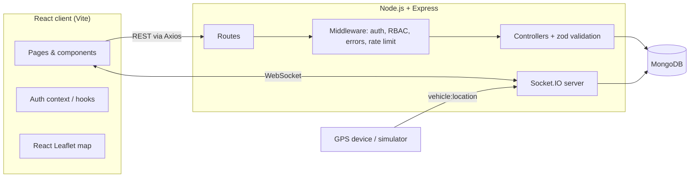

# 🚚 Real-Time Logistics & Fleet Tracking System


A full-stack, real-time logistics and fleet management platform. Dispatchers watch vehicles move on a live map, create and assign shipments, and follow every delivery from pickup to drop-off. Managers get dashboards and reports. Customers can track a parcel on a public page without logging in.

---

## 📑 Table of Contents

1. [Quick Start](#-quick-start)
2. [Features](#-features)
3. [System Architecture](#-system-architecture)
4. [Technology Stack](#-technology-stack)
5. [Project Structure](#-project-structure)
6. [Data Models](#-data-models)
7. [REST API Reference](#-rest-api-reference)
8. [Real-Time Events](#-real-time-events-socketio)
9. [Roles & Permissions](#-roles--permissions)
10. [Configuration](#-configuration)
11. [Running with Docker](#-running-with-docker)
12. [GPS Simulator](#-gps-simulator)
13. [Testing](#-testing)
14. [Security](#-security)
15. [CI/CD & Deployment](#️-cicd--deployment)
16. [Roadmap](#-roadmap)
17. [Contributing](#-contributing) · [License](#-license)

---

## 🚀 Quick Start

**Prerequisites:** Node.js 18+ (20 LTS recommended), npm, and MongoDB 6/7 running locally (or a MongoDB Atlas URI).

```bash
# 1. Backend
cd server
npm install
npm run seed        # creates demo users, vehicles, drivers and shipments
npm run dev         # API + sockets on http://localhost:5000

# 2. Frontend (new terminal)
cd client
npm install
npm run dev         # app on http://localhost:5173

# 3. Make the vehicles move (new terminal)
cd server
npm run simulate
```

Open **http://localhost:5173** and sign in:

| Role | Email | Password |
|---|---|---|
| Admin | `admin@fleet.com` | `Admin@123` |
| Manager | `manager@fleet.com` | `Manager@123` |
| Dispatcher | `dispatcher@fleet.com` | `Dispatch@123` |

Then open **Live tracking** to see four seeded trucks driving toward their destinations. The public tracking page is at `/track` (try a tracking ID from the Shipments page).

> ⚠️ The demo accounts are for development only. Never run `npm run seed` against a production database (it wipes all collections) and remove the demo users before going live.

---

## ✨ Features

### 📊 Dashboard
- Vehicle KPIs: total, moving, idle/stopped, in maintenance.
- Shipment KPIs: ongoing, waiting for assignment, delivered, on-time rate, fleet utilization.
- Charts (Recharts): deliveries in the last 7 days, shipments by status.
- Recent shipments table. KPIs refresh live when shipments or vehicle status change.

### 📍 Live Fleet Tracking
- Interactive OpenStreetMap map (React Leaflet) with status-colored vehicle markers.
- Positions update in real time over Socket.IO (no polling).
- Dashed route line from each in-transit vehicle to its destination, with distance and ETA.
- Search by plate or driver name, filter by status, click a vehicle to focus it.
- Connection indicator ("Live updates on" / "Reconnecting").

### 🚛 Vehicle Management
- Add, edit, delete, search and filter vehicles.
- Registration, type, make/model, capacity, fuel type, status, assigned driver.
- Next service date and insurance expiry.

### 👨‍✈️ Driver Management
- Driver profiles with phone, email, license number and expiry.
- Availability status (`available`, `on-trip`, `off-duty`), assigned vehicle, rating.

### 📦 Shipment Management
- Create shipments with an auto-generated tracking ID (`SHP-YYYYMMDD-NNNN`).
- Distance and ETA calculated automatically.
- Assign an idle vehicle and an available driver in one dialog.
- Guided status lifecycle: `Created → Assigned → Picked Up → In Transit → Delivered` (or `Failed` / `Cancelled`). Invalid jumps are rejected by the API.
- Full status timeline per shipment.
- **Public tracking page** for customers (`/track/:trackingId`), showing only customer-safe fields.

### 🗺️ Route Management
- Source, destination, distance and driving-time estimate for every shipment, drawn on a map.
- Multi-stop planner that orders stops with a nearest-neighbour heuristic.

### 📈 Reports & Analytics
- Deliveries per day (7/30/90 days), vehicle utilization, driver performance, on-time rate.
- CSV export for each table; print or save as PDF through the browser.

### 🔔 Alerts
- Automatic alerts for speeding (over 80 km/h, de-duplicated per vehicle) and failed deliveries.
- Real-time toast + unread counter in the sidebar, alerts page with mark-as-read.

### 🔐 Authentication & Access Control
- JWT access + refresh tokens; the client refreshes silently when the access token expires.
- Role-based access control (admin, manager, dispatcher, driver) on every API route and in the UI.

### 🎨 UI
- Responsive layout (sidebar collapses on mobile), loading and empty states, toast feedback, keyboard-visible focus, reduced-motion support.

---

## 🏗️ System Architecture



Request flow: `Route → authenticate/authorize → controller (zod-validated) → Mongoose model`. Controllers emit Socket.IO events after changes so every open dashboard stays in sync.

---

## 🛠️ Technology Stack

### Frontend (`client/`)
| Technology | Purpose |
|---|---|
| React 18 + Vite 5 | UI and build tooling |
| JavaScript (ES2022), HTML5, CSS3 | Application code |
| Tailwind CSS 3 | Styling |
| React Router 6 | Routing, protected and lazy-loaded routes |
| Axios | API client with token refresh interceptor |
| Socket.IO client | Live vehicle and shipment updates |
| React Leaflet + Leaflet | Interactive maps (OpenStreetMap tiles) |
| Recharts | Dashboard and report charts |
| React Hot Toast, Lucide React, date-fns | Notifications, icons, dates |

### Backend (`server/`)
| Technology | Purpose |
|---|---|
| Node.js 18+ / Express 4 | REST API |
| MongoDB + Mongoose 8 | Database and models |
| Socket.IO 4 | Real-time communication |
| jsonwebtoken + bcryptjs | Authentication, password hashing |
| Zod | Request validation |
| Helmet, CORS, express-rate-limit | Security hardening |
| Morgan | HTTP request logging |
| node:test | Unit tests |

### DevOps
Docker and Docker Compose (MongoDB, API, Nginx-served client). Nginx proxies `/api` and `/socket.io` to the API.

---

## 📂 Project Structure

```text
logistics-fleet-tracking/
├── client/
│   ├── src/
│   │   ├── components/   Layout, CrudPage, MapView, Modal, StatusBadge, DashboardCard, Spinner
│   │   ├── pages/        Login, Dashboard, FleetTracking, Vehicles, Drivers, Shipments,
│   │   │                 Routes, Reports, Alerts, TrackShipment (public), NotFound
│   │   ├── context/      AuthContext.jsx
│   │   ├── hooks/        useFleetTracking.js
│   │   ├── routes/       ProtectedRoute.jsx
│   │   ├── services/     api.js (Axios + refresh), socket.js
│   │   ├── utils/        helpers.js
│   │   ├── App.jsx · main.jsx · index.css
│   ├── Dockerfile · nginx.conf · tailwind.config.js · vite.config.js · package.json
│
├── server/
│   ├── src/
│   │   ├── config/       env.js, db.js
│   │   ├── models/       User, Vehicle, Driver, Shipment, Alert, constants
│   │   ├── controllers/  auth, crud (generic), shipment, dashboard, report, route, alert, track
│   │   ├── middleware/   auth (authenticate/authorize), errorHandler
│   │   ├── routes/       index.js
│   │   ├── sockets/      tracking.js, io.js
│   │   ├── services/     alertService.js
│   │   ├── validators/   schemas.js (zod)
│   │   ├── utils/        geo.js, trackingId.js, ApiError.js, asyncHandler.js
│   │   ├── seed/         seed.js, cities.js
│   │   ├── simulator/    simulate.js
│   │   ├── app.js · server.js
│   ├── tests/            geo.test.js
│   ├── Dockerfile · package.json · .env.example
│
├── docker-compose.yml · .env.example · .gitignore · LICENSE · README.md
```

---

## 🗃️ Data Models

| Model | Key fields |
|---|---|
| **User** | name, email (unique), passwordHash, role, isActive, lastLogin |
| **Vehicle** | registrationNo (unique), type, make, model, capacityKg, fuelType, status, assignedDriver, location `{lat,lng}`, speed, heading, lastUpdated, nextServiceDate, insuranceExpiry |
| **Driver** | name, phone, email, licenseNo (unique), licenseExpiry, status, rating, assignedVehicle |
| **Shipment** | trackingId (unique), customerName, customerPhone, pickup/delivery `{address,lat,lng}`, weightKg, status, vehicle, driver, distanceKm, eta, deliveredAt, timeline[] |
| **Alert** | type, severity, message, vehicle, shipment, isRead |

---

## 🔌 REST API Reference

Base URL: `/api/v1`. Everything except `/health`, `/auth/login`, `/auth/refresh` and `/track/:trackingId` needs `Authorization: Bearer <accessToken>`.

| Module | Method | Endpoint | Access |
|---|---|---|---|
| System | GET | `/health` | Public |
| Auth | POST | `/auth/login`, `/auth/refresh` | Public (rate limited) |
| Auth | GET / POST | `/auth/me`, `/auth/logout` | Any user |
| Public | GET | `/track/:trackingId` | Public |
| Dashboard | GET | `/dashboard/stats` | Any user |
| Vehicles | GET | `/vehicles`, `/vehicles/:id` | Any user |
| Vehicles | POST / PUT | `/vehicles`, `/vehicles/:id` | Admin, manager |
| Vehicles | DELETE | `/vehicles/:id` | Admin |
| Drivers | GET / POST / PUT / DELETE | `/drivers`, `/drivers/:id` | Same split as vehicles |
| Shipments | GET | `/shipments`, `/shipments/:id` | Any user |
| Shipments | POST | `/shipments` | Admin, manager, dispatcher |
| Shipments | PATCH | `/shipments/:id/assign`, `/shipments/:id/status` | Admin, manager, dispatcher |
| Shipments | DELETE | `/shipments/:id` | Admin |
| Routes | GET | `/routes/:shipmentId` | Any user |
| Routes | POST | `/routes/optimize` | Admin, manager, dispatcher |
| Reports | GET | `/reports/deliveries`, `/reports/vehicles`, `/reports/drivers` | Admin, manager |
| Alerts | GET / PATCH | `/alerts`, `/alerts/:id/read`, `/alerts/read-all` | Any user |

List endpoints accept `page`, `limit` (max 200), `search` and a `status` filter (plus `type` for vehicles).

```jsonc
// success
{ "success": true, "data": {}, "meta": { "page": 1, "limit": 50, "total": 134 } }
// error
{ "success": false, "message": "Validation failed", "errors": [{ "field": "email", "message": "Invalid email" }] }
```

---

## ⚡ Real-Time Events (Socket.IO)

Clients connect with the same JWT (`auth: { token }`) and join the `fleet` room automatically.

| Event | Direction | Payload |
|---|---|---|
| `vehicle:location` | Device → server | `{ vehicleId, lat, lng, speed, heading }` (admin/manager/dispatcher tokens only) |
| `vehicle:location` | Server → clients | `{ vehicleId, lat, lng, speed, heading, status, timestamp }` |
| `vehicle:status` | Server → clients | `{ vehicleId, status }` |
| `shipment:update` | Server → clients | `{ shipmentId, status, eta }` |
| `alert:new` | Server → clients | Alert document |

---

## 👥 Roles & Permissions

| Capability | Admin | Manager | Dispatcher | Driver |
|---|:---:|:---:|:---:|:---:|
| View dashboard, map, shipments, vehicles, drivers | ✅ | ✅ | ✅ | ✅ (read-only) |
| Create / assign shipments, update status | ✅ | ✅ | ✅ | ❌ |
| Add / edit vehicles and drivers | ✅ | ✅ | ❌ | ❌ |
| Delete vehicles, drivers, shipments | ✅ | ❌ | ❌ | ❌ |
| View reports | ✅ | ✅ | ❌ | ❌ |

---

## 🔑 Configuration

**`server/.env`** (copy from `.env.example`)

```env
NODE_ENV=development
PORT=5000
MONGO_URI=mongodb://localhost:27017/fleet_tracking
JWT_ACCESS_SECRET=change_me_access
JWT_REFRESH_SECRET=change_me_refresh
JWT_ACCESS_EXPIRES=15m
JWT_REFRESH_EXPIRES=7d
CLIENT_URL=http://localhost:5173
```

In production the server refuses to start while the JWT secrets still contain `change_me`.

**`client/.env`**

```env
VITE_API_BASE_URL=http://localhost:5000/api/v1
VITE_SOCKET_URL=http://localhost:5000
```

Never commit real `.env` files.

---

## 🐳 Running with Docker

```bash
cp .env.example .env          # set two long random JWT secrets
docker compose up --build
```

| Service | URL |
|---|---|
| App (Nginx) | http://localhost:3000 |
| API | http://localhost:5000/api/v1/health |

Load demo data into the containerized database:

```bash
docker compose exec server node src/seed/seed.js
docker compose exec server node src/simulator/simulate.js
```

---

## 🛰️ GPS Simulator

`npm run simulate` logs in as the admin, finds every **In Transit** shipment, and drives its vehicle toward the destination, pushing `vehicle:location` events exactly like a real GPS unit. It marks the shipment **Delivered** on arrival and occasionally spikes above 80 km/h to trigger speeding alerts.

```bash
npm run simulate -- --interval=2000 --speedup=40 --vehicles=10
```

New shipments you move to In Transit in the UI are picked up automatically. Override credentials with `SIM_EMAIL`, `SIM_PASSWORD` and `API_URL`.

To connect real hardware, have your device gateway authenticate and emit the same `vehicle:location` event.

---

## 🧪 Testing

```bash
cd server && npm test
```

Currently covers the geo utilities (distance, movement, route ordering, ETA). Adding API tests (Jest + Supertest) and client tests (Vitest) is on the roadmap.

---

## 🔐 Security

- Passwords hashed with bcrypt (12 rounds); hashes are never returned by the API.
- Short-lived JWT access tokens plus refresh tokens; sockets use the same JWT.
- Role checks on every protected route; unknown body fields are stripped by zod (no mass assignment).
- Helmet headers, CORS limited to `CLIENT_URL`, JSON body limit, rate limiting on login and refresh.
- Query filters are whitelisted and typed; search input is regex-escaped.
- Public tracking exposes only customer-safe fields.
- Secrets come from environment variables; `.env` is git-ignored.

Before real production use also add HTTPS (Nginx/TLS), refresh-token revocation, and remove the demo accounts.

---

## ☁️ CI/CD & Deployment

Sample GitHub Actions workflow (`.github/workflows/ci.yml`):

```yaml
name: CI
on:
  push: { branches: [main] }
  pull_request:
jobs:
  build:
    runs-on: ubuntu-latest
    steps:
      - uses: actions/checkout@v4
      - uses: actions/setup-node@v4
        with: { node-version: 20 }
      - run: cd server && npm install && npm test
      - run: cd client && npm install && npm run build
```

Deployment options: Docker Compose on an AWS EC2 instance behind Nginx/TLS with MongoDB Atlas, or the client on S3/CloudFront and the API on any container host.

---

## 🗺️ Roadmap

Built: dashboard, live map, vehicle/driver/shipment management, routes and planner, reports, alerts, JWT auth with RBAC, Docker, GPS simulator.

Planned:
- [ ] API tests (Jest + Supertest) and client tests (Vitest), ESLint/Prettier, pre-commit hooks
- [ ] User management screen and refresh-token revocation
- [ ] Trip history playback (store GPS breadcrumbs with a TTL index)
- [ ] Geofencing, idle-time and route-deviation alerts
- [ ] Email / SMS / WhatsApp delivery notifications
- [ ] Driver mobile app with own-shipment view and proof of delivery
- [ ] Road-based routing and AI route optimization
- [ ] Dark mode, marker clustering for large fleets
- [ ] Swagger/OpenAPI docs, Prometheus metrics and Grafana dashboards, structured logging
- [ ] Redis adapter for multi-instance Socket.IO, multi-tenant support
- [ ] Predictive maintenance, fuel monitoring, driver behavior analytics

---

## 🤝 Contributing

1. Fork the repo and create a branch: `git checkout -b feature/your-feature`.
2. Use Conventional Commits (`feat: add geofencing alerts`).
3. Make sure `npm test` (server) and `npm run build` (client) pass.
4. Open a pull request with a clear description and screenshots for UI changes.

## 📄 License

Released under the **MIT License**. See `LICENSE`. Replace the copyright holder in `LICENSE` with your name.

---

**Built with React.js | Smart Logistics | Real-Time Fleet Visibility** 🚚
